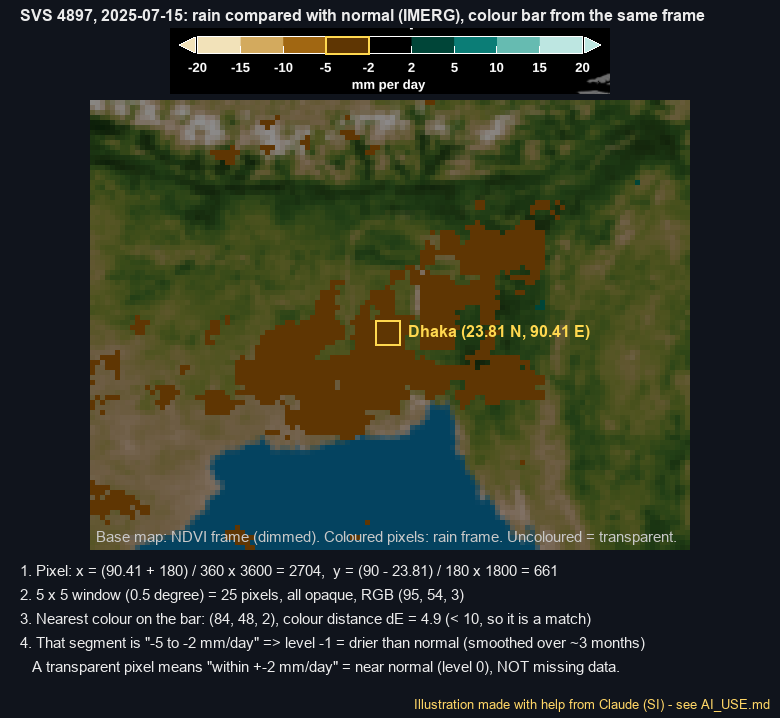

# Earth Jukebox — start here (for Sabik)

Written Nov 12 as design notes. **All project code, data processing and assets are made on Nov 14–15**; before that we only learn the data
and write plans like this one, and we declare these notes in the AI/SI section of the submission. The example below was a quick one-off
check to explain the method; it is not project code, and the real pipeline is written from scratch on Nov 14.

## What option A means
| Disc | Read from | What the user hears about | Label in the app |
|---|---|---|---|
| Rain | SVS 4897 frames (IMERG rain compared with normal, smoothed over ~3 months) | wetter or drier than normal | "Rain: wetter or drier than normal" |
| NDVI | SVS 5544 frames (VIIRS vegetation) | how green the land is | "Vegetation greenness: low to high" (from the image's colour scale; the scale has no NDVI numbers) |

- **Side A/B** = the same place, the same 12 calendar months, two years: rain 2025 vs 2026, NDVI 2024 vs 2025.
  Rain 2026 has no Nov–Dec yet ⇒ those months play as crackle ("missing data").
- **Same colour-to-sound rules** for every place, year and side. Only the scale and instrument change by region.
- **First milestone:** one place × one dataset working end to end (Dhaka × rain × 2025), then expand.

## Worked example 1 — rain, Dhaka, 15 July 2025


1. Frame: `https://svs.gsfc.nasa.gov/vis/a000000/a004800/a004897/frames/3600x1800_2x1_15p/flatalpha/imergvar_alpha.2025.07.15.png`
   (3600×1800, 0.1° per pixel, only the data layer, transparent elsewhere).
2. Place → pixel: `x = floor((90.41 + 180) / 360 × 3600) = 2704`, `y = floor((90 − 23.81) / 180 × 1800) = 661`.
3. Take the 5×5 window around it (about 0.5°): all 25 pixels are opaque, colour RGB (95, 54, 3).
4. Compare with the 8 colours of the colour bar (in CIELAB): nearest is (84, 48, 2) = "2 to 5 mm/day drier than normal", colour distance ΔE = 4.9 ≤ 10 ⇒ a match.
5. Level of this frame = median of the 25 pixel levels = **−1** (drier than normal).
6. On Nov 14 the month value is the median of 5 frames (days 1, 8, 15, 22, 28).

Same frame, Mekong delta (Can Tho, 10.03 N, 105.78 E): pixel (2857, 799); 24 of 25 pixels are **transparent** ⇒ level 0 each, one pixel is
(0, 69, 56) ⇒ +1; median = **0 = near normal**. Transparent means "within ±2 mm/day", **not** missing data. Check alpha first: transparent pixels
still carry leftover RGB values such as (54, 54, 54).

## Worked example 2 — NDVI, same date
Frame `.../a005544/frames/8640x4320_2x1_30p/equirectangular/SNPP_VIIRS.20250715.ndvi_w_snow.oceanblue.png` (8640×4320, 15 MB).
Colour bar `.../a005544/NDVI_colorbar.png`: a smooth gradient, left = Low, right = High, no numbers ⇒ we read the **position** 0–1 along it.

| Place | Pixel | Typical colour | Position on the bar | Level |
|---|---|---|---|---|
| Dhaka | (6489, 1588) | (179, 158, 92) | ≈ 0.36 | 2 (low to medium) |
| Sahara | (4392, 1584) | (218, 186, 153) | ≈ 0.15 | 1 (low) |
| Amazon | (2823, 2243) | (31, 61, 19) | 1.00 (end of bar ⇒ saturated) | 4 (high) |
| Pacific Ocean | (720, 2160) | (8, 123, 176) blue | no match | null |
| Greenland | (3360, 360) | (255, 255, 255) snow | excluded | null |

NDVI frame colours sit about ΔE 9 away from the bar, so the match limit for NDVI is 15 (with 10, about half the land pixels fail).

## Small example of the JSON we expect
Numbers below are made up but follow the rules in `03_json.md`. Two discs = Side A and Side B of the same place.
```json
{
  "version": 1,
  "generated": "2026-11-14T09:00:00Z",
  "provenance": {
    "source": "Colours read from NASA SVS frames (Earth Information Center)",
    "made_with": "Python pipeline written by the team with help from Claude (SI); see AI_USE.md"
  },
  "datasets": {
    "rain": {
      "label": "Rain: wetter or drier than normal",
      "unit": "mm/day compared with normal, smoothed over ~3 months",
      "svs": "4897", "svs_url": "https://svs.gsfc.nasa.gov/4897",
      "levels": [
        { "level": -4, "min": null, "max": -15, "value": -17.5, "label": "15+ mm/day drier than normal" },
        { "level": -3, "min": -15, "max": -10, "value": -12.5, "label": "10 to 15 mm/day drier" },
        { "level": -2, "min": -10, "max": -5, "value": -7.5, "label": "5 to 10 mm/day drier" },
        { "level": -1, "min": -5, "max": -2, "value": -3.5, "label": "2 to 5 mm/day drier" },
        { "level": 0, "min": -2, "max": 2, "value": 0, "label": "near normal (within 2 mm/day)" },
        { "level": 1, "min": 2, "max": 5, "value": 3.5, "label": "2 to 5 mm/day wetter" },
        { "level": 2, "min": 5, "max": 10, "value": 7.5, "label": "5 to 10 mm/day wetter" },
        { "level": 3, "min": 10, "max": 15, "value": 12.5, "label": "10 to 15 mm/day wetter" },
        { "level": 4, "min": 15, "max": null, "value": 17.5, "label": "15+ mm/day wetter than normal" }
      ]
    },
    "ndvi": {
      "label": "Vegetation greenness: low to high",
      "unit": "position on the image's colour scale (0 = low, 1 = high); the scale has no NDVI numbers",
      "svs": "5544", "svs_url": "https://svs.gsfc.nasa.gov/5544",
      "levels": [
        { "level": 1, "min": 0, "max": 0.25, "label": "low greenness" },
        { "level": 2, "min": 0.25, "max": 0.5, "label": "low to medium greenness" },
        { "level": 3, "min": 0.5, "max": 0.75, "label": "medium to high greenness" },
        { "level": 4, "min": 0.75, "max": 1, "label": "high greenness" }
      ]
    }
  },
  "places": [
    { "id": "dhaka", "name": "Dhaka, Bangladesh", "lat": 23.81, "lon": 90.41, "biome": "monsoon-delta",
      "region": "south-asia", "story": "One sentence from Bormey." }
  ],
  "discs": [
    { "id": "dhaka-rain-2025", "place": "dhaka", "dataset": "rain", "year": 2025, "side": "A",
      "levels": [0, 0, -1, -1, 0, 1, -1, -1, 0, 1, 2, 1],
      "values": [0, 0, -3.5, -3.5, 0, 3.5, -3.5, -3.5, 0, 3.5, 7.5, 3.5],
      "saturated": [false, false, false, false, false, false, false, false, false, false, false, false],
      "frames_used": [5, 5, 5, 5, 5, 5, 5, 5, 5, 5, 5, 5],
      "match_pct": 99.6, "median_de": 2.1, "condition": "mint", "breaks": [],
      "frame": "data/frames/dhaka-rain-2025.png",
      "source": { "svs": "4897", "svs_url": "https://svs.gsfc.nasa.gov/4897",
        "frames": "https://svs.gsfc.nasa.gov/vis/a000000/a004800/a004897/frames/3600x1800_2x1_15p/flatalpha/",
        "sample_days": [1, 8, 15, 22, 28] },
      "description": "Rain compared with normal around Dhaka in 2025. Brown means drier, teal means wetter.",
      "check": null },
    { "id": "dhaka-rain-2026", "place": "dhaka", "dataset": "rain", "year": 2026, "side": "B",
      "levels": [1, 1, 0, 0, -1, -2, -1, 0, 1, 2, null, null],
      "values": [3.5, 3.5, 0, 0, -3.5, -7.5, -3.5, 0, 3.5, 7.5, null, null],
      "saturated": [false, false, false, false, false, false, false, false, false, false, false, false],
      "frames_used": [5, 5, 5, 5, 5, 5, 5, 5, 5, 5, 2, 0],
      "match_pct": 99.1, "median_de": 2.4, "condition": "scratched", "breaks": [],
      "frame": "data/frames/dhaka-rain-2026.png",
      "source": { "svs": "4897", "svs_url": "https://svs.gsfc.nasa.gov/4897",
        "frames": "https://svs.gsfc.nasa.gov/vis/a000000/a004800/a004897/frames/3600x1800_2x1_15p/flatalpha/",
        "sample_days": [1, 8, 15, 22, 28] },
      "description": "Rain compared with normal around Dhaka in 2026. November and December are not recorded yet.",
      "check": null }
  ]
}
```

## Who owns which files (so we never edit the same file)
| Sabik | Ky |
|---|---|
| `pipeline/**` (Python + tests), `docs/data/discs.json`, `docs/data/frames/**`, `docs/js/schedule.js` (pure, no Tone.js) + `docs/js/schedule.test.mjs`, `docs/js/audio.js`, `docs/vendor/**` | `docs/index.html`, `docs/css/**`, `docs/js/{app,store,ui-list,ui-jukebox,roll,a11y,validate,audio-stub}.js` + their tests, `docs/data/discs.sample.json`, README, HOW_IT_WORKS, AI_USE, CREDITS |

The JSON format (`03_json.md`) is our contract: agree it in the first 30 minutes on Nov 14; after that only **add** fields, and tell each other.

## Reading order
`02_pipeline.md` (how to read the frames) → `03_json.md` (output) → `06_tests.md` (hand-built tests, write them first) → `05_music.md` (afternoon of Nov 14).

## Your day
- **Nov 14 morning:** hand-built tests (`06`), then Dhaka × rain × 2025 end to end ⇒ `discs.json` ⇒ commit.
- **Nov 14 afternoon:** `schedule.js`: pure `schedule(disc, place, mode)` with unit tests (`node --test`), then `audio.js` playback with Tone.js.
- **Detailed prompts for each step:** `PROMPTS_SABIK.md`.
- **Nov 15:** 4–6 places × rain/NDVI × both years, regional scales/instruments, Science mode, tuning by ear.
