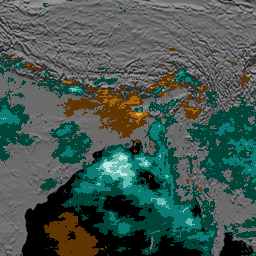

# Dhaka rain 2025 — one image to review

Prepared by Sabik with help from OpenAI Codex (SI). This is a draft review aid, not Bormey-approved alternative text.

- **Place:** centred on Dhaka, Bangladesh (23.81 N, 90.41 E), approximately the middle of the image. The wide view includes surrounding parts of India and Myanmar and the Bay of Bengal. It is not a city-boundary map. Full bounds: 77.6–103.2 E, 11.1–36.7 N.
- **Date:** 15 July 2025. This is one reference frame for the disc, not the average of the whole year.
- **Brown/tan:** drier than normal; **green/turquoise:** wetter than normal. These colours describe rainfall departures, not vegetation or floodwater.
- **Dhaka's small central sample:** the brown band labelled 2–5 mm/day drier than normal (level -1). This is a category read from NASA's colour scale, not an exact independently measured rainfall value. It does not mean only 2–5 mm of rain fell.
- **Uncoloured areas:** the underlying grey land / black ocean map shows through where this product's anomaly layer is transparent (near normal). Grey and black are basemap colours, not extra dry/wet categories.
- **Time meaning:** NASA adds each day's rainfall departure and lets it fade over about three months. So the frame contains recent accumulated/fading patterns, not just rain on 15 July. It is not a simple three-month average.

NASA explanation and credits: https://svs.gsfc.nasa.gov/4897/

[NASA full image with the date and colour key](https://svs.gsfc.nasa.gov/vis/a000000/a004800/a004897/frames/1920x1080_16x9_15p/flatcomposite/imergvar_composite.2025.07.15.png)

## Possible description (under 40 words; please review)

NASA rainfall-anomaly map centred on Dhaka, 15 July 2025. Brown near Dhaka indicates drier-than-normal conditions; green and turquoise show wetter-than-normal areas nearby. The image includes rainfall patterns that fade over about three months.

Please revise this in your own words if helpful, and send back the filename plus your description. No JSON or coding is needed. We will check that the wording matches the image and insert your reviewed version.

## Correction to the earlier file

Please use the corrected image above. The previous file sampled the wrong longitude and showed the Caribbean. The pipeline and all eight rain images/data discs were regenerated after independently checking the source map's longitude layout. The earlier July colour result happened to be the same; it did not validate the location. See `HANDOFF.md` and `evidence/geography-check.json`.
