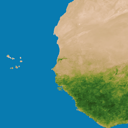
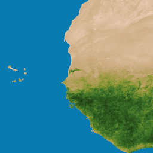
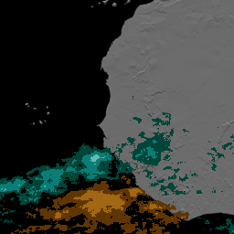
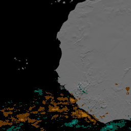

# Northern Ferlo: images and story for Bormey and Yen

Prepared by Sabik with help from OpenAI Codex (SI), 15 November 2026. Caption drafts below still need Bormey's wording review.

**Place:** Northern Ferlo near Linguere, Senegal. **Centre:** latitude 15.6035, longitude -15.2857. It is an open savanna and pasture landscape, not a pure grassland pixel or a whole-region average. NASA's [background story about herding and water](https://science.nasa.gov/earth/earth-observatory/scouting-watering-holes-from-space-146490/) explains why seasonal change matters here. The precise centre comes from [published site C2L4, Table 1](https://www.mdpi.com/2072-4292/6/3/2408).

## What listeners can compare

The greenness music reaches level 3 in **August 2024** but **September 2025**. These are observed categories in our sampled images; they do not establish a climate trend or prove when rain arrived. The 2025 value peaks in October, but music mode puts September, October and November in the same category. Details/science mode retain finer differences.

| Month | 2024 colour position | Music level | 2025 colour position | Music level |
|---|---:|---:|---:|---:|
| Jan | 0.25 | 2 | 0.27 | 2 |
| Feb | 0.23 | 1 | 0.25 | 2 |
| Mar | 0.23 | 1 | 0.25 | 2 |
| Apr | 0.23 | 1 | 0.25 | 2 |
| May | 0.23 | 1 | 0.21 | 1 |
| Jun | 0.21 | 1 | 0.21 | 1 |
| Jul | 0.19 | 1 | 0.23 | 1 |
| Aug | 0.51 | 3 | 0.25 | 2 |
| Sep | 0.56 | 3 | 0.61 | 3 |
| Oct | 0.51 | 3 | 0.74 | 3 |
| Nov | 0.46 | 2 | 0.54 | 3 |
| Dec | 0.27 | 2 | 0.25 | 2 |

Every vegetation month uses 3 frames (days 5, 15 and 25). These values are positions on the NASA image's colour scale, **not measured NDVI values**. The same thresholds apply to every place and year. Rain has level 0 in every valid Ferlo month; the 2026 November/December entries are missing. Level 0 means near normal, not no rain.

## Four images and caption drafts

Each image is centred on the sampling point, but covers a much broader area than the approximately 47 × 49 km vegetation sampling window. All four reference images are dated 15 July of the relevant year. They are not annual averages.

### ferlo-ndvi-2024.png

Draft: Northern Ferlo, Senegal, on NASA's vegetation map from 15 July 2024. Pale tan near the centre indicates low greenness; greener areas lie farther south. Blue marks the ocean. The colours represent relative vegetation greenness.

[Full NASA image](https://svs.gsfc.nasa.gov/vis/a000000/a005500/a005544/frames/4096x2048_2x1_30p/equirectangular_w_dates/SNPP_VIIRS.20240715.ndvi_w_snow.oceanblue.annotated.png)

### ferlo-ndvi-2025.png

Draft: Northern Ferlo, Senegal, on NASA's vegetation map from 15 July 2025. Pale tan near the centre indicates low greenness; greener areas lie farther south. Blue marks the ocean. The colours represent relative vegetation greenness.

[Full NASA image](https://svs.gsfc.nasa.gov/vis/a000000/a005500/a005544/frames/4096x2048_2x1_30p/equirectangular_w_dates/SNPP_VIIRS.20250715.ndvi_w_snow.oceanblue.annotated.png)

### ferlo-rain-2025.png

Draft: Northern Ferlo, Senegal, on NASA's 15 July 2025 rainfall-anomaly map. Grey near the centre shows the near-normal category; green means wetter and brown drier than usual. Recent differences build up and fade over about three months.

[Full NASA image](https://svs.gsfc.nasa.gov/vis/a000000/a004800/a004897/frames/3600x1800_2x1_15p/flatcomposite/imergvar_composite.2025.07.15.png)

### ferlo-rain-2026.png

Draft: Northern Ferlo, Senegal, on NASA's 15 July 2026 rainfall-anomaly map. Grey near the centre shows the near-normal category; green means wetter and brown drier than usual. Recent differences build up and fade over about three months.

[Full NASA image](https://svs.gsfc.nasa.gov/vis/a000000/a004800/a004897/frames/3600x1800_2x1_15p/flatcomposite/imergvar_composite.2026.07.15.png)

## Read, review and write

- Read NASA's explanations: [rainfall departures, SVS 4897](https://svs.gsfc.nasa.gov/4897/) and [vegetation images, SVS 5544](https://svs.gsfc.nasa.gov/5544/). The [vegetation colourbar](https://svs.gsfc.nasa.gov/vis/a000000/a005500/a005544/NDVI_colorbar.png) runs from Low to High without numerical NDVI labels.
- Check the filename, date, centre and colour meaning against each linked image. Keep captions at 40 words or fewer. Descriptions should explain that particular image, not claim it depicts a flood, drought, exact rainfall amount or a measured climate trend.
- Add the filename and reviewed wording in the [existing team document, places tab](https://docs.google.com/document/d/1XgIDQHjdR-5IGtX96clUcxXklNICMZ_j9mVAuMOil0I/edit?tab=t.uv0ru88njche). Keep existing place introductions. These drafts are not yet inserted as reviewed app descriptions.
